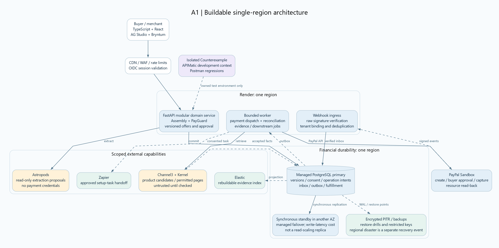
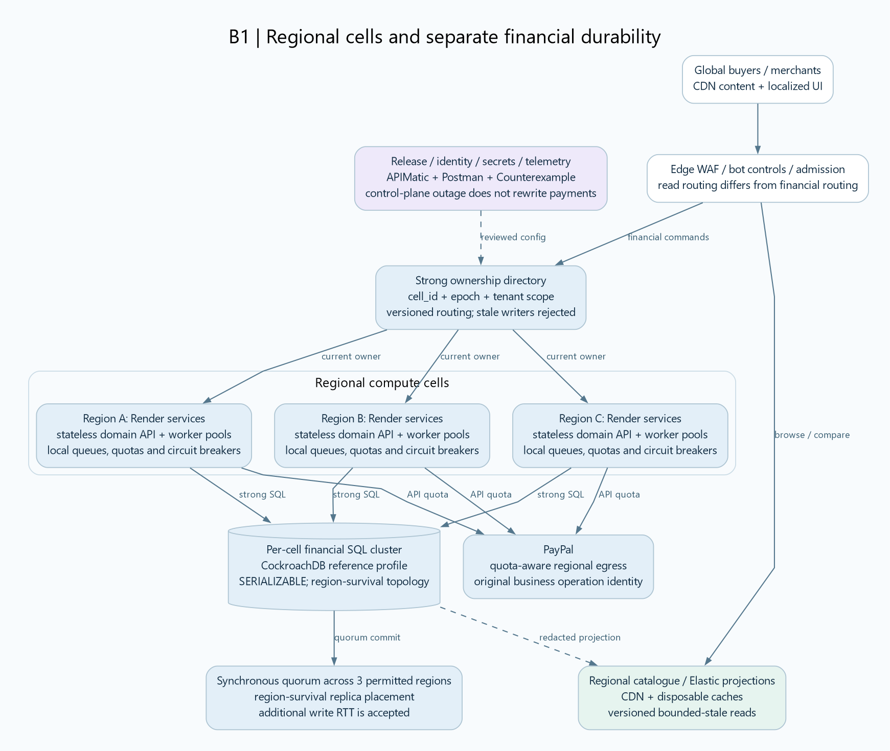

# Assembly Proof: two system architectures

**Decision:** Assembly is the customer product, PayGuard is its authority and payment module, and Counterexample is an isolated verification harness. These are logical responsibilities. They do not require three independent products or three autonomous agents.

**Architecture A is the implementation target. Architecture B is a production evolution.** Both preserve all ten sponsor roles. Neither is implemented, security-certified, load-tested, or demonstrated to reduce losses by this document. Research cutoff: November 1, 2026.

[Open the complete 14-diagram gallery](DIAGRAMS.md). Each diagram has a vector SVG, PNG preview, editable Graphviz source, and Mermaid flow source. Graphviz is the verified rendering path. The Mermaid sources are portable alternative flow views, not independently rendered in this pack.

## 1. Resolve the requirements before choosing infrastructure

| Requested property | Engineering interpretation |
|---|---|
| Maximize profits and reduce any kind of loss | Improve useful purchase completion while limiting wrong configurations, unauthorized effects, duplicate work, unresolved payments, and operating cost. Benefit needs a merchant pilot; no architecture eliminates fraud, credit, delivery, legal, market, or software risk. |
| Balanced CAP | Prefer consistency for authority, budgets, inventory and financial commands. Prefer availability with bounded staleness for browsing/search. During a partition, an isolated minority cannot keep authorizing money. CAP consistency is not the same as every meaning of ACID consistency or SQL isolation. |
| High reliability and traffic surges | Bound admission, isolate pools, prioritize recovery, provision headroom and test failover. Autoscaling alone does not fix a database hotspot or a provider quota. |
| Easy to build with no bugs or vulnerabilities | Start with a small modular application and managed services. Use typed boundaries, independent tests and a threat model. Zero defects cannot be promised. |
| Billions of users and transactions | A reference scale objective, not a benchmark. Specify transactions per second, traffic mix, geography, tenant skew, provider quotas and retention before sizing. |
| Hold billions in local currencies | These designs are **noncustodial**. They store amounts, permissions and provider references. PayPal or another appropriately licensed provider holds/settles actual funds. A custodial wallet requires a separately scoped ledger, treasury, safeguarding and operating model. |
| OWASP financial security | Use ASVS 5.0.0 as a versioned verification baseline, the API Security Top 10 2023 for API threats, and GenAI guidance for model/tool threats. A control map is not compliance certification. |

The realistic initial audience is a participating merchant selling configurable recording-equipment bundles. The buyer specifies capability, budget and readiness deadline. The system checks a modeled configuration, binds the accepted offer to authority, executes through PayPal and verifies the result. The merchant can inspect the same record and run failure tests against its owned integration.

Channel3 listings are discovery evidence. They do not permit accepting payments for arbitrary listed retailers. The demonstration must use a controlled sandbox seller and clearly label simulated seller prices, stock or lead times.

## 2. Architecture A: one region, managed durability, modular application

### Components and ownership

| Component | Responsibility | Failure policy |
|---|---|---|
| TypeScript/React + AG Studio + Bryntum | Guided configuration, evidence inspection, material-term review and readiness dependencies | UI never grants financial authority or declares capture from a browser callback. |
| Edge + managed OIDC identity | TLS, WAF, rate limits, authentication and abuse controls | Sensitive commands require valid server-side authorization; public content can remain available. |
| FastAPI domain service | Tenant/actor authorization, Assembly checks, offer versions, PayGuard policy, purchase state and narrow PayPal adapter | Keep explicit modules with one authoritative state model; no unbounded agent loop. |
| Managed PostgreSQL | Immutable accepted versions, consent, budgets, stock reservations, payment intents, inbox/outbox and commitments | Use a provider-supported synchronous standby in another AZ for the reference design. Read authoritative state from the writer. |
| Bounded worker | Evidence preparation, payment dispatch/reconciliation, inbox processing and approved downstream jobs | Separate concurrency budgets, stable identities, explicit timeouts and visible failures. |
| Object storage + backups | Redacted source artifacts, traces, permitted browser evidence and restore material | Encryption, tenant-scoped access, retention, integrity metadata and restore drills. |
| Astropods / Channel3 / Kernel / Elastic | Bounded preparation and retrieval | Missing critical facts remain unknown; an unavailable model cannot relax policy. Accepted payment snapshots do not depend on a fresh search call. |
| Counterexample | Owned-fixture testing and independent verdicts | Separate environment, credentials, database, namespaces and sandbox-only target policy. |

**Deployment choice:** Render hosts the application and workers. The financial database can be a managed PostgreSQL Multi-AZ service with synchronous replication, such as the documented RDS profile. Keep compute and database geographically close, use verified TLS and narrowly restricted connectivity, and assess actual network latency. Do not assume Render private networking extends to an external cloud database.

Render's documented Postgres HA uses **asynchronous** replication and can lose recent writes during failover. It is not a drop-in replacement for the synchronous financial durability contract. It may be used as an explicitly labeled sandbox shortcut, but that shortcut does not establish production readiness. A restored stale database must not automatically resume money operations.

The synchronous standby protects the stated single-AZ failure model; it is not a read-scaling replica. Regional disaster recovery is separate. Off-region backups do not provide zero-data-loss automatic regional promotion. If the state is uncertain, keep financial operations unavailable until recovered and reconciled. Provider contract, fencing and actual failover behavior must be tested.

### Modules rather than microservices

Use packages for `identity`, `catalogue_evidence`, `configuration`, `offers`, `authority`, `payments`, `fulfillment`, `audit`, and `test_contracts`. Separate transport from domain decisions and persistence. Share typed contracts, not unrestricted database access. Add Redis, Kafka, Kubernetes or a separate systems-language service only when measured needs justify them.

Use async I/O for supported HTTP/database calls. Inspect the selected PayPal SDK's transport rather than assuming it is asynchronous; isolate blocking calls in a bounded execution path. Pool database connections with explicit per-instance limits so scaling API instances does not exhaust the database.

### The transaction contract

See [A2 purchase flow](diagrams/A2-purchase-flow.svg) and [A3 capture state machine](diagrams/A3-capture-state.svg).

1. AI extracts proposed requirements/facts. Deterministic checks evaluate capability, quantity, compatibility, budget and readiness. Unknown critical facts prevent an unsupported acceptance.
2. The participating merchant issues an immutable, expiring offer. The canonical material manifest includes merchant identity, exact product variants, quantities, integer total, currency and any material delivery/acceptance terms. Display-only text need not invalidate financial consent.
3. An authenticated actor accepts that offer under a versioned policy. A digest identifies the canonical snapshot; it is not proof of product truth or user identity by itself.
4. Persist a unique order-create intent before calling PayPal. Store the provider order ID and the original request identity. PayPal buyer approval is separate from our application's consent record.
5. Before capture, perform a short database transaction: check actor/policy/offer versions and expiry; reserve applicable budget and controlled merchant stock; persist the exact capture operation and its dispatch identity. A queued request does not retain authority after expiry. Keep database locks out of remote calls.
6. The worker dispatches the original operation outside the transaction. Use a stable provider request key for the endpoint and a fixed body hash. The local budget governs operations routed through this system, not every external action on the merchant's PayPal account.
7. Record provider evidence. A browser redirect or approval callback does not establish completed capture. Match provider account, order/capture identity, amount, currency and status.
8. If the outcome is unknown, retain the reservation and original operation. Read authoritative resources or use a supported exact retry within its retention contract. Never create replacement authority because a timeout elapsed. If outcome cannot be established safely, enter operator review.
9. Commit the verified result and fulfillment outbox together. The outbox is at-least-once delivery. A unique commitment and replay-safe downstream interface are needed to avoid repeated effects. A local unique row cannot guarantee an external warehouse ships only once.
10. Refunds are separate capture-linked operations with their own approvals, identities, pending amounts and reconciliation. A pending refund does not restore usable budget or imply money has returned. Refund destination is bound to the original transaction, not an arbitrary model-proposed payee.

**Revocation semantics:** acknowledge cancellation as final only before the durable dispatch transition. After dispatch begins, represent it as a cancellation request until the provider outcome is known. Neither a DB lock nor an application epoch can retract a request already accepted by PayPal.

### Data model and constraints

See [A4 data model](diagrams/A4-data-model.svg).

| Record / constraint | Purpose |
|---|---|
| `UNIQUE(tenant_id, business_intent_id)` on purchase | Two fresh HTTP request IDs must not silently create two business purchases. |
| Unique logical payment operation and provider request identity | Scope by tenant/provider account, operation kind and logical sequence. Same key with a different body is rejected. |
| Tenant identity included in foreign keys | Prevent cross-tenant relations even when opaque IDs are known. |
| Versioned offer, consent and policy | Material changes require a new decision; historical decisions remain inspectable. |
| Atomic budget and stock reservations | Concurrent transactions cannot each spend or promise the same remaining allowance/stock. Keep unresolved reservations until an evidence-based transition. |
| Unique provider app/event ID in inbox | Process authentic repeated deliveries without duplicate state effects. Distinct event IDs can still describe the same business effect, so fulfillment also needs its own identity. |
| Unique purchase/effect-kind commitment | Appropriate for this single-fulfillment demo; model split fulfillment explicitly if added. |
| Append-only application observations | Retain provenance and causal IDs. Access-controlled/WORM storage can strengthen tamper resistance where supported; a hash chain alone does not prevent deletion or forged source data. |

Represent money as checked integer minor units with explicit ISO currency and scale, using `NUMERIC(38,0)` for amounts/aggregates where required. Validate provider-supported bounds and precision. Do not use floating point, implicitly convert currencies, add incompatible currencies, or interpret a reporting projection as a wallet balance.

Index the actual query shapes: `(tenant_id, purchase_id)`, `(operation_state, next_attempt_at)`, `(tenant_id, source_variant_id, evidence_version)`, and `(run_id, sequence)`. Keep pending operations hot, archive historical observations by retention policy, and avoid time partitioning that removes uniqueness protection for active business identities. Use expand/contract migrations; retain readers for older event and scenario versions. Test restoration with unresolved operations present.

### Security and verification

See [A5 security boundaries](diagrams/A5-security-boundaries.svg) and [A6 Counterexample](diagrams/A6-counterexample.svg).

Use separately authored expected outcomes and trace checks. The production verifier may be reused between UI and server, but the independent test oracle must not merely call it and declare correctness. Test valid, invalid and incomplete configurations; material changes; expiry; concurrent requests; response loss; worker crashes; duplicate/out-of-order normalized events; stale offers; refund ambiguity; and external task ambiguity.

Control faults only in the owned application. Verify authentic PayPal ingress before internally replaying a normalized event. Clearly distinguish synthetic, recorded and real sandbox observations. Local replay does not rewind PayPal. A reduced trace must preserve the same rule violation and prerequisites; do not claim a globally minimal proof from greedy deletion.

## 3. Architecture B: regional cells with quorum financial state

This is an evolution after product validation. It deliberately adds cost and complexity to address regional failures, tenant isolation and sustained scale. It is not the November implementation target.

### Topology and database decision

Deploy regional stateless application/worker cells with local admission control, scoped credentials and independent resource limits. Render can continue hosting those services where its actual regions, connectivity, account limits and operational guarantees fit. Do not assume a drawn cell implies a provider-supported multi-AZ placement, unlimited replicas or a private link to another cloud.

Keep read projections regional. Catalogue, evidence search, analytics and nonfinancial caches can be rebuilt. Route money commands to the current authority owner and its financial state. Isolate giant or noisy tenants into separate cells as required.

For the reference financial database, use managed CockroachDB with **explicit `SERIALIZABLE` transactions and a supported region-survival topology**. The current documentation describes at least three database regions and five replicas distributed 2+2+1 for the region-failure goal. Writes coordinate across regions and incur extra latency. This is the reason to consider distributed SQL rather than pretending ordinary asynchronous Postgres replicas provide the same contract.

Confirm plan/version support, tested failure behavior and legal data placement before choosing regions. Keep regulated residency cohorts in separate supported geographic groups; region survival cannot justify moving data outside permitted locations. PostgreSQL wire compatibility is not complete feature compatibility: test migrations, locking, retry semantics, tenancy controls and every relied-upon extension before migration. Do not assume PostgreSQL RLS policies transfer unchanged.

The ownership directory is strongly versioned metadata; it can live in the financial SQL system rather than adding a separate consensus product. Cache routing for efficiency, but validate current ownership before money dispatch. A minority partition has no authority to continue writes. A separate cell with a healthy quorum can keep serving its own tenants.

### Consistency and authority scopes

See [B2 consistency/ownership](diagrams/B2-consistency-ownership.svg).

| Operation | Required behavior under partition |
|---|---|
| Browse candidates or inspect old evidence | Serve a bounded-stale projection with visible version/age where useful. Availability favored. |
| Change a draft requirement | Save a local draft if safe, but mark it uncommitted to authoritative purchase state until accepted. |
| Accept terms, reserve budget/stock, prepare capture/refund | Require authoritative state, serializable conflict handling and current ownership. Pause when it cannot be established. |
| Observe an unresolved payment | Return the last confirmed status plus an explicit unresolved state. Never invent paid/failed status. |
| Update a search index or create a setup task | Eventually consistent, replay-safe and independent from financial success. |

`SERIALIZABLE` does not mean every read in every product path is linearizable, nor does it make a PayPal call part of the SQL transaction. Use appropriate strong current-state reads for authority. Retry database-only transaction callbacks on serialization conflicts with bounded jitter. Do not put a PayPal or Zapier side effect inside a callback that the database/driver may replay.

Co-locate each shared budget and inventory authority with the purchases it governs. A cached global counter is not sufficient. One unpartitioned hot budget row can become the bottleneck even in a large cluster. A future design may allocate durable bounded sub-budgets to cells, provided total allocations never exceed the parent and ambiguous in-flight authority cannot be reallocated. That mechanism requires its own specification and tests; it is excluded from Architecture A.

### Peak-load protection

See [B3 surge control](diagrams/B3-traffic-surges.svg).

Use separate pools for browse/search, AI preparation, financial dispatch, reconciliation/webhook work and optional downstream actions. Apply tenant fairness and explicit bounds to queue depth, job age, provider calls, model tokens, page sizes, browser sessions and retries. Check authority and offer expiry again after queueing.

Return `429` for rejected excess and `202` only for a durably accepted job; queued is not paid. When the database is unavailable, do not acknowledge durable receipt that did not occur. Coalesce duplicate requests, cache nonfinancial results and cancel obsolete AI drafts. Preserve capacity for resolving unknown payments so new demand cannot starve recovery.

Autoscale using measured saturation, queue age, execution latency and connection usage. Render's native documented autoscaling is CPU/memory based; queue-aware scaling requires a separately implemented controller or another supported runtime. Respect provider quotas and `Retry-After`; extra pods do not expand them. Set the minimum and maximum replica counts from load tests rather than a global-user slogan.

### Failover and disaster recovery

See [B4 failover](diagrams/B4-failover.svg).

1. A failed owner must lose access to new dispatch. The current financial quorum determines durable operation state and ownership epoch.
2. A recovered worker claims the original operation using compare-and-set and durable identity. The egress gateway checks current authority. Already-emitted requests remain a provider reconciliation problem.
3. Resolve known in-flight operations using provider IDs and documented idempotency contracts. Do not treat elapsed leases as proof of no financial effect.
4. Preserve ambiguous reservations. Retention expiry, missing evidence or a provider outage can require manual review. There is no finite recovery-time guarantee for every external ambiguity.
5. Restore traffic gradually, preserving provider quota for reconciliation and checking backlog, replica health and write contention.

The specified region-survival database topology targets durability/availability for the declared region-failure model while quorum remains. It does not survive arbitrary simultaneous faults, malicious privileged actions, software defects or every corruption scenario. Maintain independent encrypted backups and restore drills. Never promote an asynchronous disaster copy and claim it retains zero lost authority records.

### Funds and financial reconciliation

See [B5 funds boundary](diagrams/B5-funds-reconciliation.svg). Actual funds remain with PayPal/the provider and participating merchant accounts. The application stores financial instructions and references, not customer deposits.

Reconcile captures, refunds and application commitments with authoritative provider resources. Settlement schedules and fees follow the provider's terms; captured amount is not the same as available settled cash. A local reporting projection cannot certify a provider ledger balance. Investigate exceptions instead of rewriting the audit history to make totals match.

See [B6 regional security](diagrams/B6-security-operations.svg) for runtime, lower-trust AI/test environments, operator access, secrets, audit, backup and incident-response boundaries.

## 4. All ten sponsor tools in both architectures

See [S1 sponsor ownership](diagrams/S1-sponsor-ownership.svg).

| Sponsor | Architecture A | Architecture B | Proof of substantial use |
|---|---|---|---|
| AG Grid / AG Studio | Linked configuration/evidence/payment workspace | Tenant-scoped merchant and incident workspace | A selection or custom widget changes the useful view and exposes source-backed reasons. |
| APIMatic | PayPal Context Plugin during adapter development | Same contract discipline for maintained adapters | A real development contribution, resulting code and verified negative test; no invented runtime role. |
| Astropods | One bounded extraction stage | Quota-limited extraction per region/cohort as supported | Deployed invocation, typed output, prompt/model version and trace. |
| Bryntum | Readiness dependencies for delivery/setup/testing | Merchant readiness/resource planning on the same domain contracts | A schedule change changes the modeled feasible purchase. |
| Channel3 | Candidate and exact-variant discovery | Cached regional discovery subject to freshness/usage terms | An actual response influences a selected configuration; not decorative cards. |
| Elastic | Evidence retrieval projection | Partitioned evidence/incident retrieval with tenant filters | Relevant result supports a decision and survives a simple baseline comparison. |
| Kernel | Permitted missing-spec page inspection and owned checkout QA | Isolated browser workers with strict egress/credential scopes | Browser evidence linked to a fact or defect; no claim of remote deterministic replay. |
| Postman | API baseline and regression export | Release/canary regressions with redacted fixtures | Reproducible fail-before/fix-after assertions. |
| Render | App and bounded worker deployments | Regional runtime services and controlled releases where supported | A real deployment and recovery demonstration; database choice need not be Render. |
| Zapier | Approved post-payment external setup task | Same scoped handoff behind an outbox and tenant consent | Actual remote ID, approved content, destination and ambiguous-outcome handling. |

All ten integrations remain proposed. Actual account access, plan limits, regional placement, service authentication, data terms and licenses must be verified. No financial command should require all ten dependencies to be healthy at once.

## 5. OWASP control map and verification evidence

| Threat / standard area | Architectural control | Required negative evidence |
|---|---|---|
| API1 / API3 / API5: object, property and function authorization | Server-side tenant/actor checks, explicit writable fields, least-privilege roles, Postgres RLS as defense in depth where supported | Another tenant's purchase ID, protected property or admin function is denied. |
| Broken authentication and session handling | Mature OIDC, validated issuer/audience/expiry, secure cookies, CSRF protection and privileged-role MFA/step-up | Token substitution, stale session and replayed sensitive action do not grant authority. |
| Injection and unsafe output handling | Parameterized SQL, typed schemas, contextual HTML encoding, CSP, no model-generated shell or SQL execution | Malicious text remains data in prompts, HTML, database queries and tool calls. |
| API4 / API6: resource and business-flow abuse | Tenant/action quotas, bounded model/browser work, job expiry, cost caps and anti-automation controls | Burst/retry floods cannot mint repeated purchases or create unbounded work. |
| API7: SSRF | Allowed hosts/schemes, controlled redirects, DNS/IP validation and isolated egress | Private IP, metadata service, redirect and DNS-rebinding cases are blocked. |
| API8 / API9 / API10 | Versioned API inventory, disabled test routes, strict third-party schemas, dependency and configuration review | Deprecated/debug endpoints and malformed provider responses cannot bypass checks. |
| GenAI prompt injection and excessive agency | No model payment credentials, no arbitrary tool execution, independent policy enforcement, typed proposals and scoped retrieval | A product page requesting a new payee or relaxed limit cannot authorize that action. |
| Secrets, logging and data access | Scoped key manager, rotation, encrypted storage/transit, minimized payer data, redacted traces and access logging | Tokens and sensitive payloads are absent from exports, browser recordings and model context. |
| Financial business logic | Immutable material terms, checked money types, explicit operation identity, durable reservations and reconciliation | Concurrent spend, stale approval, response loss and repeated normalized events do not create unauthorized commitments in the tested suite. |
| Release/operations | Reviewed signed artifacts where supported, dependency inventory, SAST/SCA/DAST, backups, scoped dispatch stop and incident procedures | Restore, secret rotation, vulnerable fixture and corrected fixture are independently exercised. |

Pin applicable ASVS 5.0.0 requirement IDs in the implementation's verification matrix after reading the detailed requirements. This map does not invent requirement IDs or assert certification. Follow PayPal's current checkout integration guidance to avoid collecting raw card data unnecessarily. Test signature verification on the original webhook body and restrict certificate-fetch destinations; a valid signature also requires correct application/merchant binding.

## 6. Performance, reliability and commercial measurement

See [S2 value and measurement](diagrams/S2-value-and-measurement.svg). The Data workflow here defines candidate KPIs; it does not supply historical business data or measured improvement.

### Capacity arithmetic, not a benchmark

| Explicit illustrative volume | Average completed payments / second |
|---|---:|
| One billion per 365-day year | 31.71 |
| One billion per day | 11,574.07 |
| One billion per day with a hypothetical 20x peak | 231,481.48 at the hypothetical peak |

These are alternative planning cases, not promised capacity or inferred PayPal traffic. Provider call amplification is separate: create, capture, verification and retries can require multiple calls per payment. One billion registered users says little about simultaneous sessions or payment throughput.

Before sizing, define browse/write ratio, checkout conversion, tenant skew, geography, object size, retained events, duration of peaks, model latency, provider limits and failure budget. Measure per-cell throughput at the required tail latency and recovery behavior. Then derive cell count from measured safe capacity and explicitly chosen headroom. Do not extrapolate a trivial in-memory checker into global payment throughput.

### Metric definitions

| Metric | Definition / decision |
|---|---|
| Useful purchase completion | Completed, correctly configured purchases divided by eligible initiated purchase tasks in a declared cohort/window. Requires outcome labeling; raw capture success alone is insufficient. |
| False-feasible configuration rate | Configurations incorrectly accepted against independently established facts/requirements divided by evaluated configurations. Report unknowns separately. |
| Unauthorized effect rate | Independently verified unauthorized provider or merchant effects divided by evaluated sensitive operations. Zero observed in a bounded suite is not zero production risk. |
| False-block rate | Legitimate modeled operations incorrectly denied divided by labeled legitimate operations. Revenue protection must include this cost. |
| Ambiguous-operation age | Distribution and maximum age of unresolved operations, with counts and amounts grouped by currency; do not sum unlike currencies. |
| Duplicate commitment rate | Purchases with unintended duplicate fulfillment/financial commitments divided by evaluated purchases, under the declared workflow. |
| Customer-visible availability | Eligible customer requests that obtain the specified result within the promised time. Report dependency outages and safe financial pauses, not only process uptime. |
| Recovery performance | Time to authoritative resolution and replay-safe resumption for declared failure classes; report unresolved cases. |
| Unit operating cost | Attributed model, browser, search, infrastructure and support cost per eligible task and per completed purchase. No dollar baseline is available here. |
| Merchant contribution | Merchant revenue less relevant goods/service costs, provider fees, attributable operations and realized losses; needs actual cost and accounting data. |

Do not set a production 99.99% SLO or profit/loss percentage without an operating baseline, commercial agreement and defined exclusions. Define separate browse, financial-command, payment-outcome and recovery SLOs after representative tests. Measure outcomes through a controlled pilot or defensible comparison; do not attribute all changes to AI without evidence.

## 7. Decision, implementation order and release evidence

Build Architecture A now. It offers an inspectable path to the first-prize demonstration while preserving a migration boundary for Architecture B. Do not build a global database cluster, a new ledger, multiple autonomous agents or a Kubernetes platform merely for the video.

1. Establish typed facts, material offer versions and one genuine sandbox create/approve/capture/read-back flow.
2. Add server authority, budget/stock reservation and explicit ambiguous-outcome states.
3. Add the outbox/inbox and independent failure suite before expanding optional functionality.
4. Make each sponsor branch useful in that same purchase. Keep APIMatic/Postman in the development/test boundary and Zapier downstream of verified payment plus consent.
5. Test concurrency, crash points, queue expiry, provider outages, tenant isolation, backup/restore and deployment restart. Treat a seeded defect as seeded.
6. Freeze the submission with clear account/setup/license instructions and judge access through the documented judging window. The diagrams are a design artifact, not evidence that these gates have passed.

Architecture A's full-region outage can pause payments until verified recovery. Architecture B trades regional write latency, replication cost, migration complexity and operational burden for a stronger declared regional failure model. Both still require PayPal availability, correct provider contracts and safe external effect handling.

## Sources reviewed

Primary documents retrieved on November 1, 2026; literature metadata/abstracts through Undermind. No full-text replication, production benchmark, penetration test or deployment was performed.

- [PayPal idempotency](https://developer.paypal.com/api/rest/reference/idempotency): supported endpoints, request identities, retention and concurrency caveats.
- [PayPal webhook integration](https://developer.paypal.com/api/rest/webhooks/rest/): verification, raw body, retries and mock-event limitations.
- [PayPal Orders v2 capture](https://developer.paypal.com/api/orders/v2/orders-capture): buyer approval and capture contract.
- [Render Postgres HA](https://render.com/docs/postgresql-high-availability): asynchronous replication and recent-write-loss limitation.
- [Render scaling](https://render.com/docs/scaling): plan-dependent CPU/memory autoscaling.
- [Render connection pooling](https://render.com/docs/postgresql-connection-pooling): database connection limits and pool behavior.
- [Render backups](https://render.com/docs/postgresql-backups): plan-dependent PITR and isolated restoration.
- [RDS Multi-AZ DB instances](https://docs.aws.amazon.com/AmazonRDS/latest/UserGuide/Concepts.MultiAZSingleStandby.html): synchronous standby, availability-zone scope and latency trade-off.
- [PostgreSQL synchronous replication](https://www.postgresql.org/docs/current/warm-standby.html): durability, acknowledgements and latency.
- [CockroachDB survival goals](https://www.cockroachlabs.com/docs/stable/multiregion-survival-goals): explicit region-survival placement and cross-region write cost.
- [CockroachDB transaction retries](https://www.cockroachlabs.com/docs/stable/transaction-retry-error-reference): serialization conflicts and retry handling.
- [OWASP ASVS](https://owasp.org/www-project-application-security-verification-standard/): stable 5.0.0 verification baseline.
- [OWASP API Security Top 10 2023](https://owasp.org/API-Security/editions/2023/en/0x11-t10/): API threats used in the control map.
- [OWASP excessive agency](https://genai.owasp.org/llmrisk/llm062025-excessive-agency/): scoped tools/permissions and complete mediation.
- [Gilbert and Lynch, 2002](https://doi.org/10.1145/564585.564601): CAP impossibility in the asynchronous partition model; metadata and publisher abstract reviewed.
- [AID-Guard](https://arxiv.org/abs/2608.21159): bounded authorization-to-effect research relevant to commit/recovery; abstract reviewed. Its results are not results for this project.
