# Assembly Proof: two architectures and 14 diagrams

Reference designs dated November 1, 2026. Architecture A is the buildable sandbox profile; Architecture B is a production evolution requiring engineering, security and load validation. See ARCHITECTURES.md for contracts, limitations and sources.

## A1 | Buildable single-region architecture

Render compute with managed synchronous Multi-AZ PostgreSQL. Render Postgres asynchronous HA is only a separately disclosed sandbox shortcut.

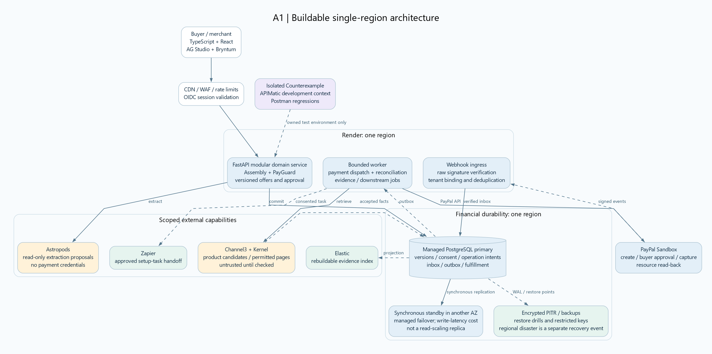

[Vector SVG](diagrams/A1-deployment.svg) | [Editable Graphviz](source/A1-deployment.dot) | [Mermaid flow source](source/A1-deployment.mmd)

## A2 | Purchase, approval and payment flow

Internal approval and PayPal buyer approval are separate. Remote calls occur outside database transactions.

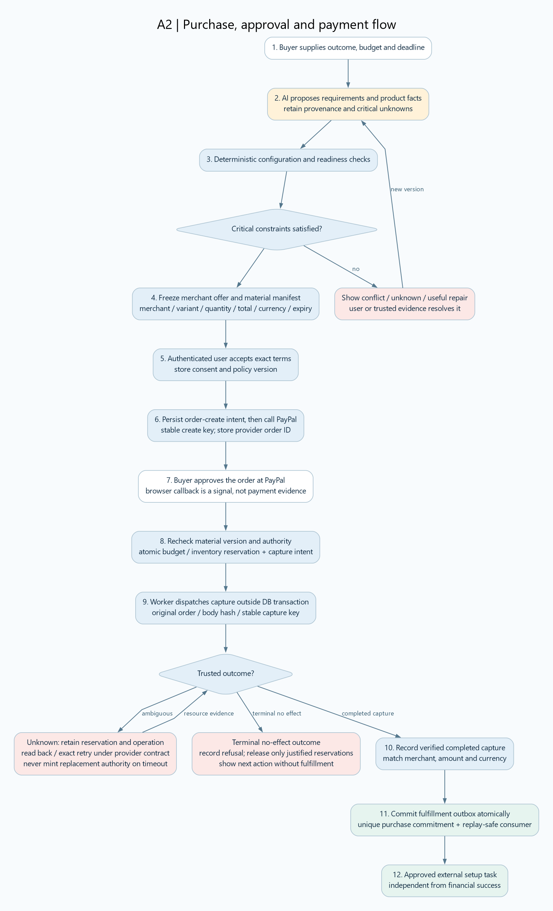

[Vector SVG](diagrams/A2-purchase-flow.svg) | [Editable Graphviz](source/A2-purchase-flow.dot) | [Mermaid flow source](source/A2-purchase-flow.mmd)

## A3 | Capture-operation state machine

State applies to one logical capture operation. Refunds are separate capture-linked operations; they do not rewind this machine.

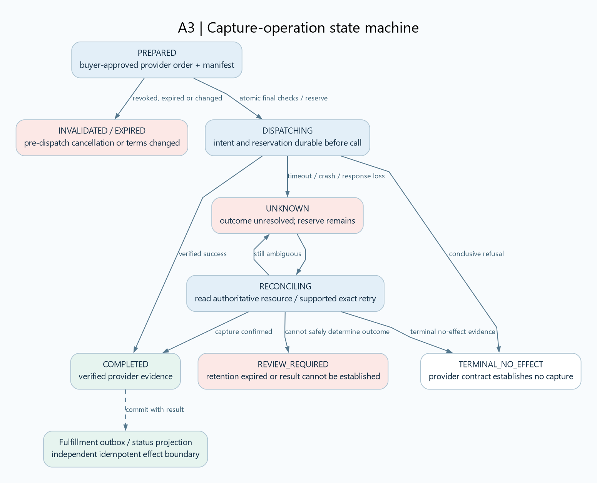

[Vector SVG](diagrams/A3-capture-state.svg) | [Editable Graphviz](source/A3-capture-state.dot) | [Mermaid flow source](source/A3-capture-state.mmd)

## A4 | Authoritative data model

Tenant-scoped keys and immutable versions. Relationship labels describe cardinality; all foreign keys also carry tenant identity.

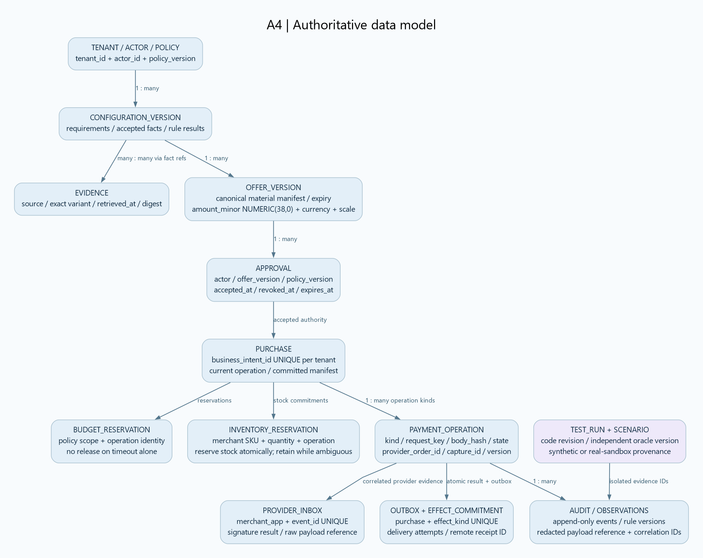

[Vector SVG](diagrams/A4-data-model.svg) | [Editable Graphviz](source/A4-data-model.dot) | [Mermaid flow source](source/A4-data-model.mmd)

## A5 | Trust and authority boundaries

OWASP-aligned control design, not a security certification. External content never grants authority.

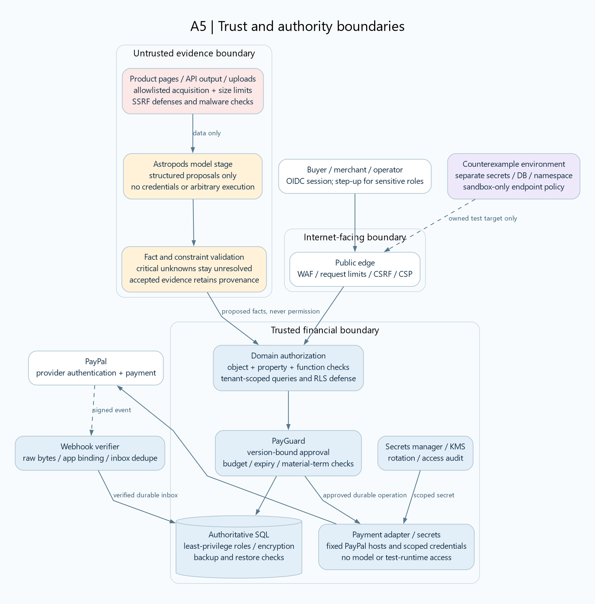

[Vector SVG](diagrams/A5-security-boundaries.svg) | [Editable Graphviz](source/A5-security-boundaries.dot) | [Mermaid flow source](source/A5-security-boundaries.mmd)

## A6 | Independent verification harness

Production rules may be shared across UI/server. The test oracle must not simply call those same production checks and certify itself.

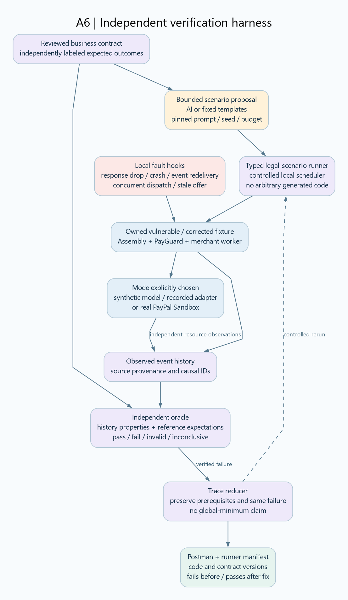

[Vector SVG](diagrams/A6-counterexample.svg) | [Editable Graphviz](source/A6-counterexample.dot) | [Mermaid flow source](source/A6-counterexample.mmd)

## B1 | Regional cells and separate financial durability

Reference production design. Repeat cells by tenant/authority scope; do not interpret three drawn cells as a capacity benchmark.

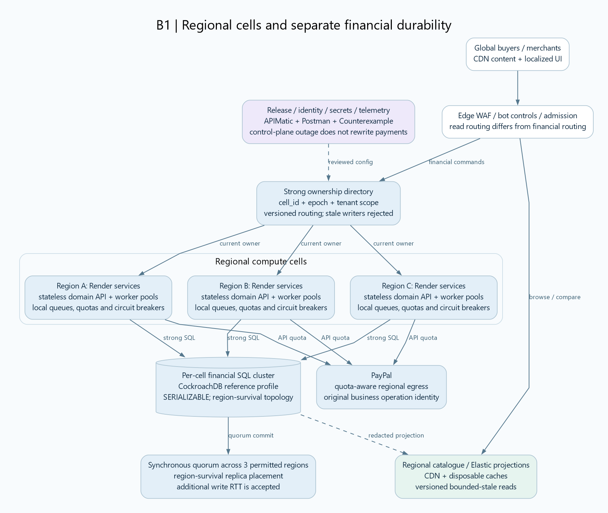

[Vector SVG](diagrams/B1-global-cells.svg) | [Editable Graphviz](source/B1-global-cells.dot) | [Mermaid flow source](source/B1-global-cells.mmd)

## B2 | Consistency, budgets and ownership

CAP is selected per operation. Serializable transactions do not atomically include PayPal or a fulfillment provider.

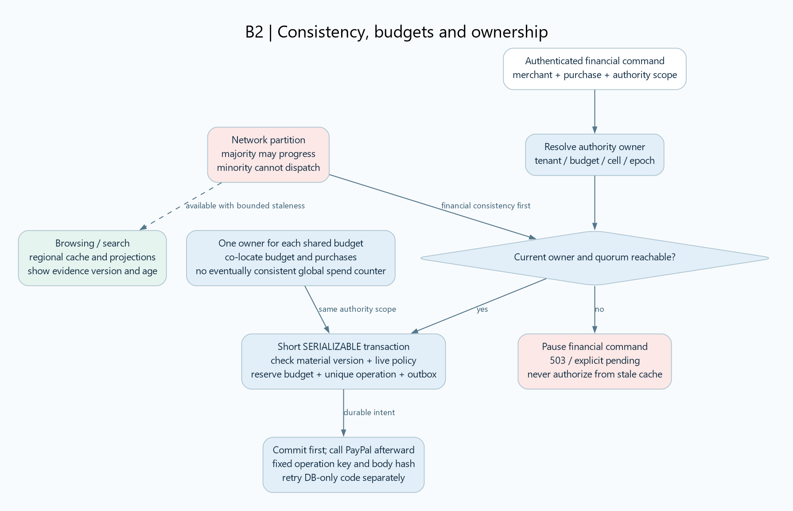

[Vector SVG](diagrams/B2-consistency-ownership.svg) | [Editable Graphviz](source/B2-consistency-ownership.dot) | [Mermaid flow source](source/B2-consistency-ownership.mmd)

## B3 | Traffic admission and backpressure

Bounded queues, fair quotas and provider limits control load. More workers do not increase PayPal's contracted capacity.

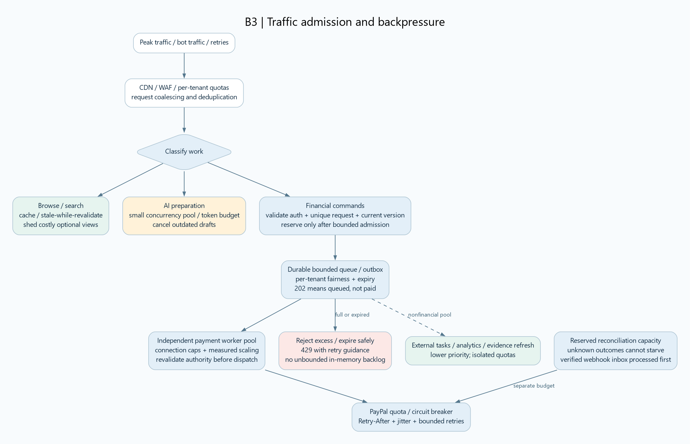

[Vector SVG](diagrams/B3-traffic-surges.svg) | [Editable Graphviz](source/B3-traffic-surges.dot) | [Mermaid flow source](source/B3-traffic-surges.mmd)

## B4 | Fenced failover and ambiguous payments

Fencing stops new stale dispatch through our gateway. It cannot cancel a request already accepted by PayPal.

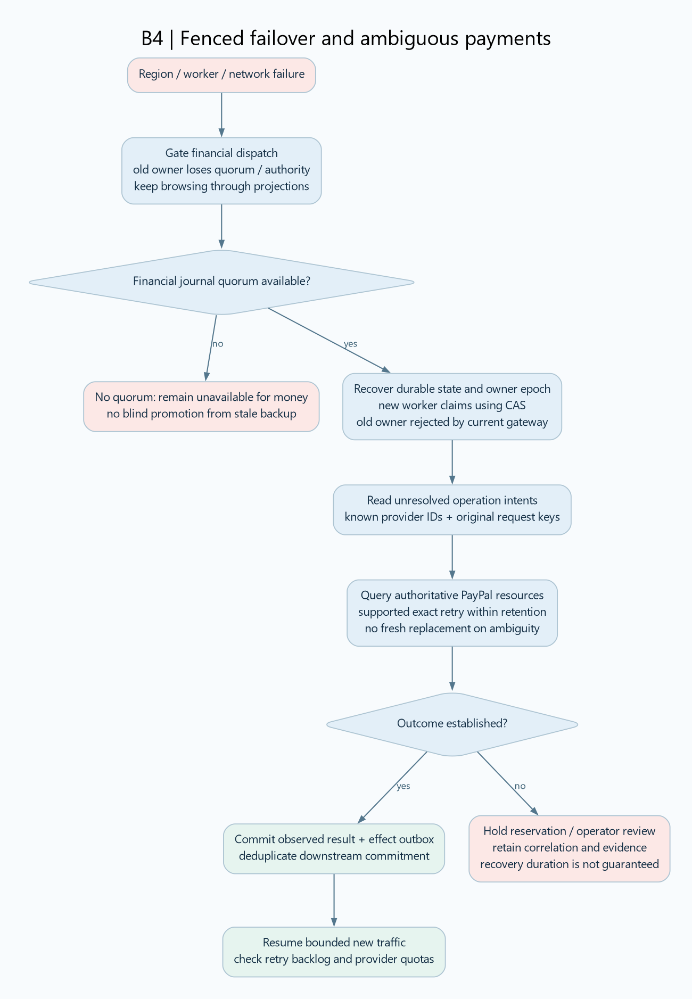

[Vector SVG](diagrams/B4-failover.svg) | [Editable Graphviz](source/B4-failover.dot) | [Mermaid flow source](source/B4-failover.mmd)

## B5 | Funds boundary and reconciliation

Assembly Proof stores instructions and financial references. PayPal / the licensed provider handles funds; this design is not a custodial wallet.

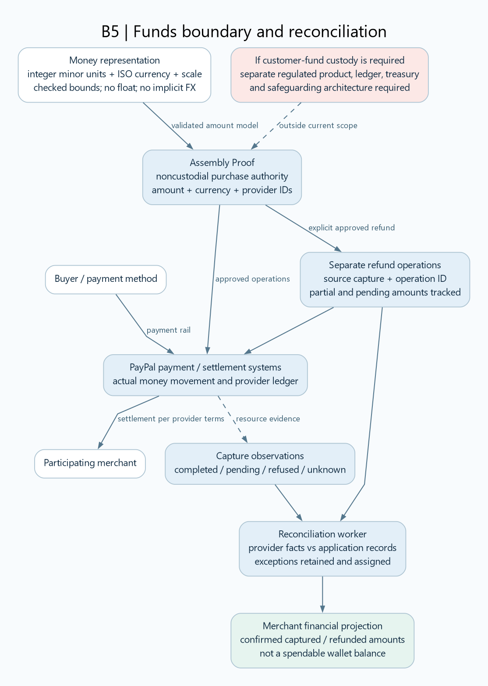

[Vector SVG](diagrams/B5-funds-reconciliation.svg) | [Editable Graphviz](source/B5-funds-reconciliation.dot) | [Mermaid flow source](source/B5-funds-reconciliation.mmd)

## B6 | Regional security and operational isolation

Use versioned OWASP ASVS requirements, API threat tests and GenAI controls. No diagram proves the absence of vulnerabilities.

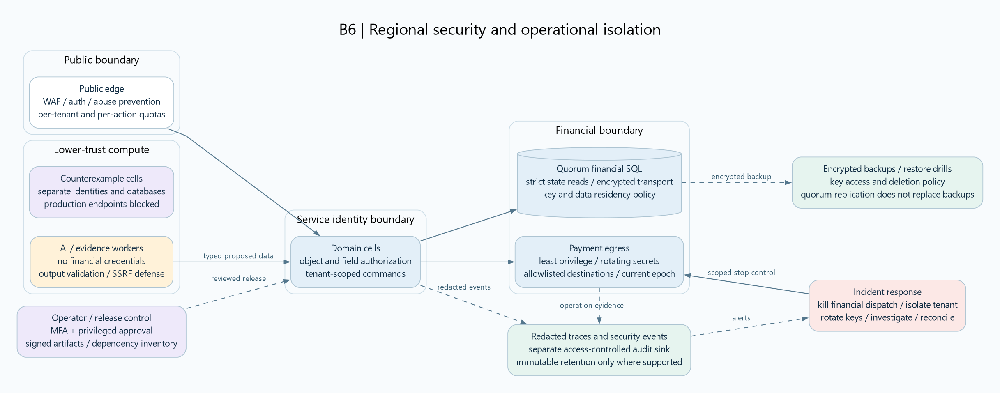

[Vector SVG](diagrams/B6-security-operations.svg) | [Editable Graphviz](source/B6-security-operations.dot) | [Mermaid flow source](source/B6-security-operations.mmd)

## S1 | All ten sponsors with bounded responsibilities

The same ownership split applies to both architectures. A meaningful integration needs a working contribution; these remain proposed.

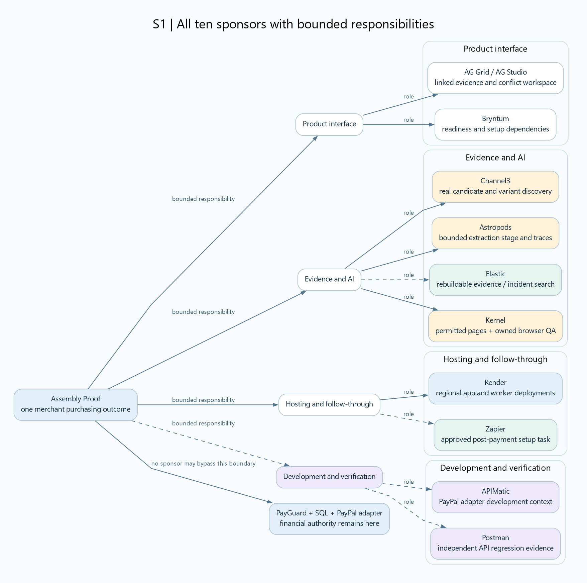

[Vector SVG](diagrams/S1-sponsor-ownership.svg) | [Editable Graphviz](source/S1-sponsor-ownership.dot) | [Mermaid flow source](source/S1-sponsor-ownership.mmd)

## S2 | Business value and loss guardrails

Hypotheses to measure in a merchant pilot. No conversion lift, loss reduction, profit or first-prize probability is established.

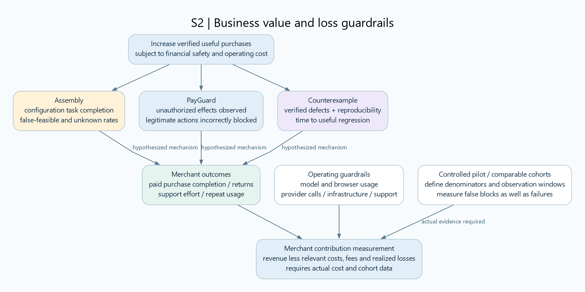

[Vector SVG](diagrams/S2-value-and-measurement.svg) | [Editable Graphviz](source/S2-value-and-measurement.dot) | [Mermaid flow source](source/S2-value-and-measurement.mmd)
