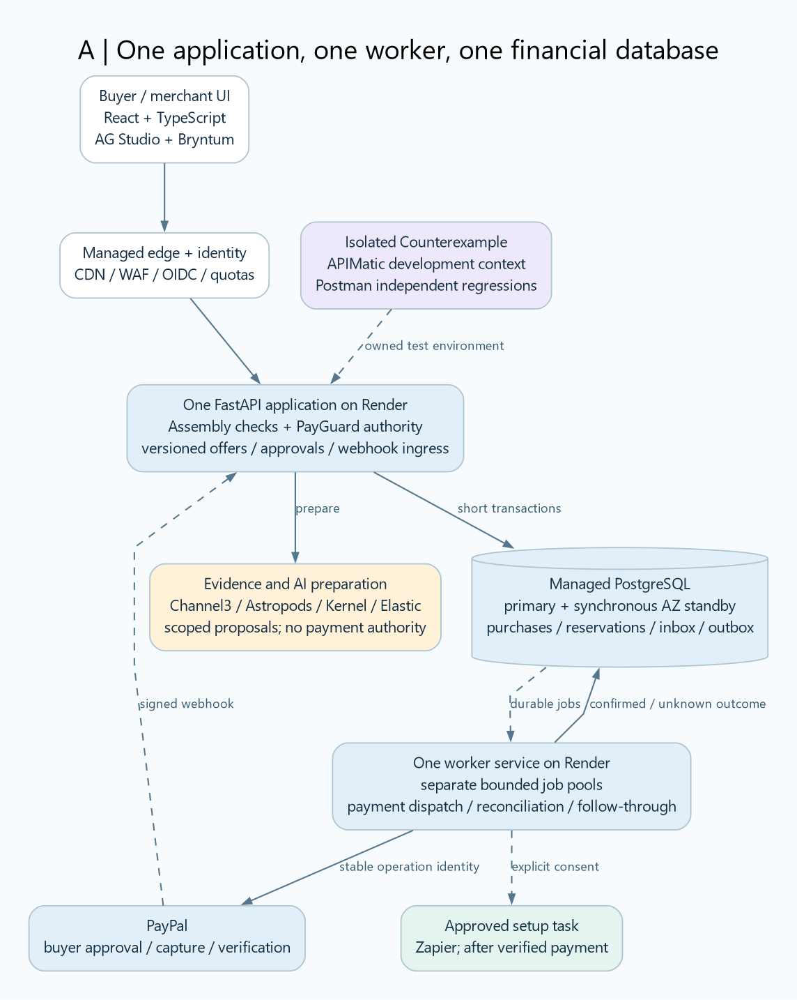
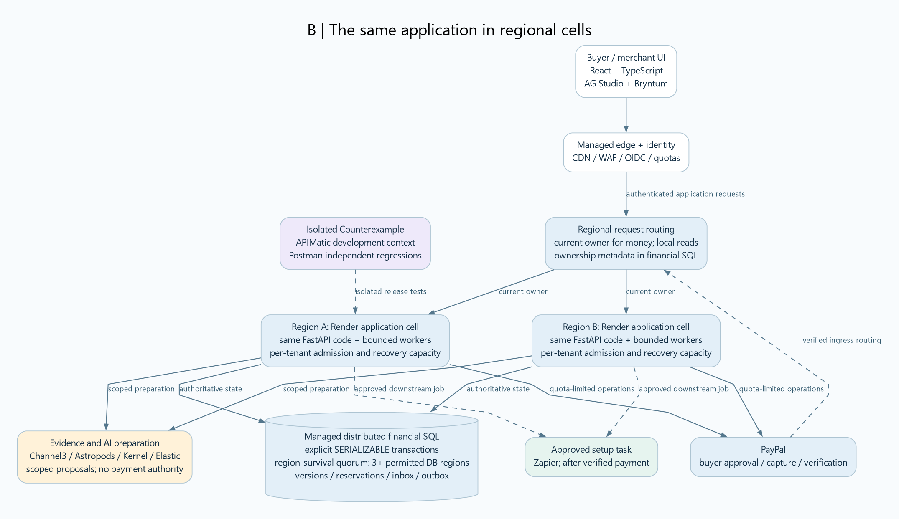

# Assembly Proof: final overall designs

Use A for the current project. B is the same product deployed across regional cells when operating requirements justify it. Both keep Assembly as the product, PayGuard as the server-side authority boundary, and Counterexample as an isolated test harness.

These consolidate the detailed A/B specification dated November 1, 2026. They preserve its payment, security and failure contracts. They are reference designs, not deployed or benchmarked infrastructure.

## A. Build this now

[Zoomable SVG](diagrams/A-final-overall.svg) | [Editable Mermaid](source/A-final-overall.mmd) | [Editable Graphviz](source/A-final-overall.dot)

The core has four parts: a static web UI, one FastAPI application, one worker service and one managed financial PostgreSQL deployment. API and worker share the same codebase and domain schemas. Render hosts compute; use a managed synchronous Multi-AZ PostgreSQL profile for financial state. A standby is part of that database deployment, not a separate application to write.

The database is also the initial durable job source: use an outbox and atomically claimed bounded work. Keep payment/reconciliation, AI preparation and optional external work under separate concurrency limits, even within one worker service. Preserve recovery capacity when new traffic spikes. Bound database connections and refuse excess work explicitly.

The API contains Assembly configuration checks, material offer versions, PayGuard authorization and authenticated webhook ingress. The worker performs the approved payment operations and reconciliation. External AI/evidence services provide proposed facts; they never grant authority. Financial decisions use accepted facts and authoritative SQL state, not a fresh search result.

This profile tolerates its declared database/AZ faults under the selected managed service contract. A complete regional disaster is a separate recovery event. Render Postgres's documented asynchronous HA must not silently replace the synchronous durability requirement; a sandbox-only shortcut does not establish production readiness.

## B. Scale the same design

[Zoomable SVG](diagrams/B-final-overall.svg) | [Editable Mermaid](source/B-final-overall.mmd) | [Editable Graphviz](source/B-final-overall.dot)

A regional cell runs the same application and bounded worker code. Each tenant and authority scope has a current owner. Store ownership metadata in the financial database; routing is a logical responsibility, not a new independent consensus service.

Use managed distributed SQL with explicit SERIALIZABLE transactions and a supported region-survival topology. The reference database choice remains CockroachDB from the detailed design. The two application regions drawn here are illustrative: the reference database's region-survival topology requires at least three permitted database regions. Compute placement and database replica placement are different decisions.

Initially share a financial cluster within each allowed residency group and partition data by tenant/authority scope. Dedicated clusters or extra shards are later decisions based on measured hotspots and isolation needs; one database cluster per small compute cell is unnecessary initially. There is no billion-user capacity claim.

Keep browse/search projections available with bounded staleness. Require current authoritative state and quorum for financial commands. A minority partition pauses money operations. The stronger regional durability model increases write latency, cost and migration/testing work.

Apply per-tenant admission, bounded job age, independent provider quotas and reserved reconciliation capacity in each cell. Scale from measured queue delay, database contention and latency. A logical queue can remain SQL-backed until a measured workload justifies a broker. A broker would transport jobs; SQL would still own financial authority.

## The same purchase contract in A and B

1. Extract proposed requirements and facts; deterministically check configuration, budget and readiness. Critical unknowns remain unresolved.
2. Freeze the merchant's material offer. The authenticated user accepts that version. Create the PayPal order with a durable operation identity; the buyer separately approves it at PayPal.
3. Before capture, recheck authority, material version and expiry. Atomically reserve applicable budget/stock and persist the exact capture operation. Do not hold a database transaction over a network call.
4. Dispatch through the payment worker. A lost response preserves the original operation and reservation. Reconcile or use a supported exact retry; never mint a fresh payment attempt merely because a timeout elapsed.
5. Record verified provider state and create the fulfillment commitment/outbox atomically. Downstream effects require replay-safe identities. Create the Zapier task only with consent and after verified payment.

Recheck permission and expiry after queueing. Cancellation is final only before durable dispatch; an already accepted provider request requires outcome reconciliation. Database ownership fencing cannot retract an in-flight provider request.

## Ten sponsors, four bounded groups

| Group | Tools and actual responsibility |
|---|---|
| Interface | AG Grid/AG Studio for linked evidence; Bryntum for meaningful readiness dependencies. |
| Evidence and AI | Channel3 for variants; Astropods for bounded extraction; Kernel for permitted pages/owned browser QA; Elastic for rebuildable evidence retrieval. |
| Hosting and follow-through | Render for API/worker deployments; Zapier for the approved downstream setup task. |
| Development and verification | APIMatic for PayPal integration context; Postman for executable regressions within the Counterexample workflow. |

All ten integrations remain proposed until working evidence exists. They do not all have to be healthy for every financial operation.

## Non-negotiable controls

- Server-side actor, tenant, object and property authorization; managed identity and privileged-role step-up.
- Strict typed inputs, parameterized SQL, safe output encoding, scoped secrets and controlled external egress.
- No AI payment credentials or arbitrary generated code execution.
- Immutable material terms, stable operation identities and provider-event verification/deduplication.
- Independent expected results and history checks: the production checker cannot be its own sole test oracle.
- Encrypted backups, redacted audit evidence, restore exercises and an explicit financial-dispatch stop control.
- Integer money representation with currency/scale and checked bounds. PayPal handles actual funds; these are noncustodial application designs.

Use the detailed design's OWASP ASVS/API/GenAI control map for verification. No architecture guarantees no bugs, vulnerabilities or financial loss.

## Choice

Build A with Python, TypeScript and SQL. Adopt B when required regional recovery, measured traffic or tenant isolation makes its additional coordination cost worthwhile. Judge performance and commercial value through tested recovery, useful purchase completion, false blocks, configuration errors, unresolved-payment age and operating cost.
