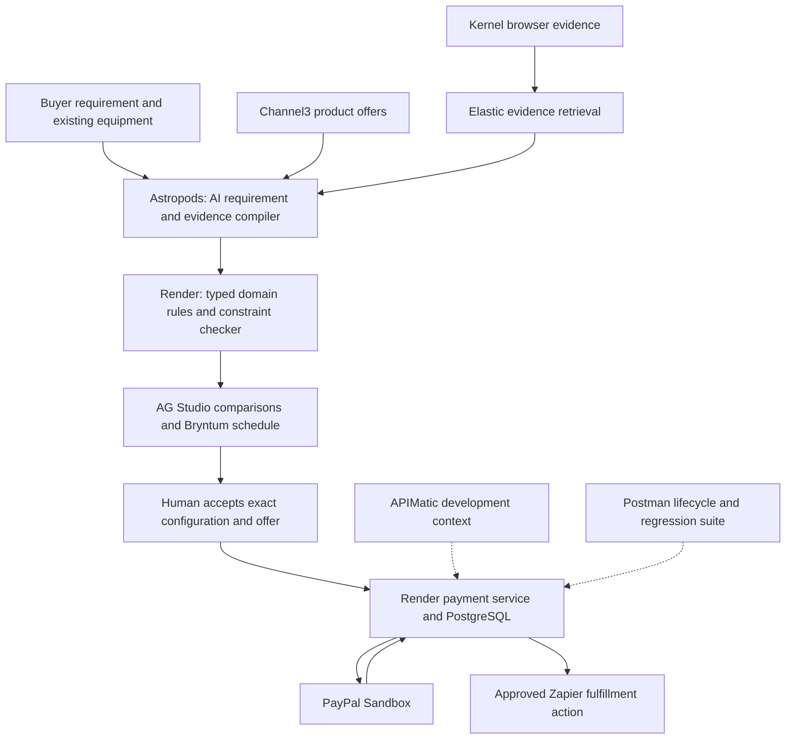

# Original PayPal + AI concepts, revision 2

Prepared 2026-10-23 for a two-person team. Status: ideation and documented feasibility review; no product implementation or sponsor connection is claimed.

This revision supersedes the earlier recommendation to use only two or three sponsors. The user requires meaningful use of all ten: AG Grid, APIMatic, Astropods, Bryntum, Channel3, Elastic, Kernel, Postman, Render and Zapier. PayGuard and the prior shortlist are not the starting project for this slate.

The initial twelve concepts were recorded in independent-concepts-v2-draft.md before this round of sponsor-document and paper searches. Prior conversation remains part of our context. This is not proof of global originality, patent novelty or absence of competing products. We have deliberately deferred a new competitor search until the user can assess these ideas.

Our decision: which original product mechanism deserves an implementation spike? My provisional preference is Assembly for overall product coherence, Checkout Wind Tunnel for infrastructure depth, and Pact for market-design ambition. These are judgments, not statistically estimated winning probabilities. The other nine concepts remain legitimate alternatives.

The supplied PDF path was unavailable in the preceding research pass; the pasted text provided the prior proposal. No claim is based on having inspected that PDF. Neither the forecast of 30,000 participants nor the number of strong final submissions is established by this review.

## 1. Assembly — compile a complete purchase into a workable system

**Audience:** small creators, studios and technical service businesses buying interconnected equipment.

**Problem hypothesis:** individual items can look appropriate while their combination cannot perform the requested job. Missing interfaces, insufficient capacity, incompatible variants and setup dependencies are often discovered after payment.

**Product:** the buyer specifies a capability, budget, existing equipment and deadline. Assembly builds a typed graph of requirements, candidate products, evidence and dependencies. It proposes a complete configuration, identifies conflicts and unknown facts, and converts the accepted version into a sandbox merchant order.

**Example:** “Set up a four-person podcast recording system under $900; I already own a laptop.” This is an illustrative budget, not a live quote. Four microphones plus an interface with two microphone inputs cannot satisfy simultaneous four-person recording. A cheaper component substitution may also require an adapter or invalidate an existing cable choice.

**Deep mechanism:**
- AI extracts proposed requirements and product claims into typed fields, each with provenance, variant identity and evidence time.
- Explicit domain rules model physical ports, capacities, quantities and compatible signal paths. Start with one audio-equipment domain, not every product category.
- Each required fact is known, contradicted or unknown. Missing specification fields do not become false or magically become true.
- A constraint solver finds feasible configurations and the conflicting subset when a configuration fails. A small independent checker validates the returned selection against the accepted facts.
- Changing a component invalidates only the affected requirements and dependent purchasing steps.
- A versioned configuration record binds the selected facts, products, merchant offer, total and approval. This records what was checked; it cannot prove that a seller's description is truthful or that hardware will work in the physical world.

**AI contribution:** interpreting goals, normalizing heterogeneous specifications, identifying useful missing evidence and explaining solver results. A fixed form with a few hardcoded product rules is an important baseline, not sufficient evidence of AI value.

**PayPal contribution:** a real Orders v2 sandbox purchase for the accepted configuration, buyer approval, server capture, status reconciliation and a demonstrated refund path. Start with one controlled sandbox seller. Channel3 listings supply real discovery/evidence, but a sandbox offer is explicitly labelled as a simulated merchant offer. We cannot accept PayPal payments on behalf of arbitrary Channel3 retailers.

**Demonstration:** enter the requirement; discover candidates; show the two-input conflict; replace the component; change one requirement and reveal affected dependencies; approve the exact simulated offer; show a genuine sandbox capture and the associated configuration record.

**Commercial hypothesis:** a merchant or specialist distributor could embed it to support complex purchases and reduce avoidable incompatible orders. Neither conversion improvement nor return reduction has been measured.

**Main failure mode:** unreliable product specifications make a polished configuration checker overconfident. Narrow the domain, retain sources, require confirmation for critical unknowns, and measure extraction independently from solver correctness.

## 2. Checkout Wind Tunnel — reproduce failures between otherwise plausible payment steps

**Audience:** merchants and developers shipping AI-driven checkout integrations.

**Problem hypothesis:** a browser can show success while backend payment state is unresolved; retry logic can create a second business order; delayed events can regress a refund state. Individual API tests may miss the interaction.

**Product:** give it an owned demo storefront, API contract and explicitly approved business invariants. It generates purchase journeys, injects faults at our application boundaries, finds violations, and exports a shortened reproducer with browser video, event trace and Postman tests.

**Deep mechanism:**
- AI proposes business journeys from UI, API and product variants. These proposals compile into a small typed scenario language.
- A deterministic runner controls scheduling, local clocks and selected application failure points.
- An append-only trace relates browser actions, application requests, PayPal IDs, persisted state and verified webhook events.
- Independently authored invariants determine failure. The same LLM must not invent the test and then declare its result correct without an external oracle.
- A reduction algorithm removes irrelevant actions and delays while preserving the observed failure. Promise a locally irreducible or shortened trace under the chosen reduction strategy, not a globally minimal proof.
- Browser recordings support human inspection; deterministic reproduction requires the application scenario, reset state, seeds and controlled scheduler. A Kernel video alone cannot replay a distributed system.

**Three useful seeded defects:**
1. Fulfillment starts on browser approval before capture is verified.
2. Two tabs create distinct PayPal orders for one application checkout attempt because the application lacks a durable uniqueness rule.
3. An old capture event causes a refunded order to appear paid again.

**Real PayPal execution:** run genuine sandbox orders and inspect actual resource status. To demonstrate ambiguous success, deliberately drop our application's response after a real capture. Do not claim to cause faults inside PayPal. Mock event runs remain visibly separate from actual sandbox-event runs.

**Demonstration:** run the correct and defective checkout versions; the agent finds a failure in the defective one; the timeline exposes the mismatch; export a reproducible regression collection; apply the independently prepared fix and rerun the same case.

**Commercial hypothesis:** integration teams could use it before release or during incident reproduction. It must outperform a simple scripted test pack on at least some held-out fault combinations to justify the AI.

**Main failure mode:** the showcase is simply a prerecorded bug sequence. Let the judge alter a variant or failure timing, and distinguish authored fixtures from generated scenarios.

## 3. Pact — a market for conditional purchasing commitments

**Audience:** small shops, community workshops and local production businesses that cannot individually meet a supplier's order threshold.

**Problem hypothesis:** compatible demand exists across buyers, but quantities, acceptable substitutes, arrival windows and price ceilings differ. Informal coordination collapses when one participant leaves.

**Product:** buyers state conditional purchase requests. Participating suppliers publish quantity tiers and availability. Pact builds a feasible coalition, exposes each buyer's exact terms and requests approval. It re-clears the proposed deal when a participant changes their commitment.

**Deep mechanism:**
- AI maps natural-language needs onto comparable product and substitution constraints.
- A deterministic batch-clearing solver respects quantity tiers, maximum unit prices, deadlines and explicitly chosen fairness rules.
- The clearing result is a versioned snapshot. Consent applies to that snapshot.
- A drop-out before settlement can invalidate the entire allocation; changed prices require renewed consent.
- Settlement remains a state machine of separate authorized PayPal payments. Ordinary REST payments do not create an atomic, all-or-nothing transaction across several buyers.

**Concrete illustrative case:** three workshops need 8, 7 and 5 kits; a participating supplier's 20-unit tier makes a joint proposal viable. If the 5-kit buyer leaves, the 15-unit group must be re-priced or cancelled. Quantities and tier terms are synthetic demo fixtures, not sourced market demand.

**PayPal contribution:** separate sandbox buyer approvals and authorizations, followed by capture under the accepted offer. Start with three sandbox buyers and one controlled seller. A failure after some captures must visibly enter partial settlement and compensation/recovery. Refunds are separate operations, not an instantaneous rollback.

**HFT connection:** batch auctions, deterministic ordering, cancellation rules, immutable logs and market replay are relevant techniques. This is procurement market design; exchange connectivity, co-location or high-frequency financial execution is not demonstrated by PayPal checkout.

**Demonstration:** requests become a viable group; one buyer leaves; the system reveals why the original price no longer holds; the remaining buyers explicitly approve revised terms or cancel; actual sandbox states show what happened.

**Main failure mode:** a compelling clearing algorithm masks an unresolved commercial commitment. The supplier must state who bears a partially settled batch. Do not advertise escrow, guaranteed savings, strategy-proofness or atomic settlement.

## Nine additional original directions

These are separate product hypotheses. Shared methods do not imply that every one should be combined into one application.

| Concept | Customer and problem | Proposed mechanism and AI role | PayPal role and demonstration | Main uncertainty |
|---|---|---|---|---|
| StockSwap | Small merchants have usable inventory stranded in the wrong business | Extract item identity and acceptable substitutions; find chains of mutually useful bilateral purchases across an inventory graph | Approved sandbox purchases between controlled sellers; remove one edge and reveal which opportunities remain | A graph cycle does not make settlement atomic or free counterparty risk; marketplace onboarding would be needed beyond controlled demos |
| ChangeOrder | A freelancer or installer accepts scope changes without understanding their payment and scheduling consequences | Compile a request change into a semantic diff of materials, labor, acceptance conditions and dependent commitments | Generate an exact incremental invoice after both sides approve the changed scope; show why “add two recording stations” changes more than quantity | Must expose ambiguous scope and disputed acceptance; no LLM legal interpretation |
| WaitWorth | Buyers commit while a cheap observation could prevent an expensive wrong purchase | Maintain alternative configurations and select the next discriminating question, inspection or sample; use explicit scenario bounds when probabilities are unavailable | Buy an approved sample or pay an agreed inspection invoice, then show how the new observation changes the final order | Expected-value calculations are meaningless if the system invents probabilities; user interviews are required |
| Promise Market | A headline price hides delivery, compatibility and return trade-offs | Normalize offers into conditional terms, show a Pareto frontier and require evidence for each promised property | A participating sandbox seller offers selectable terms; buyer pays for the chosen version | Extracted advertising text is not an enforceable guarantee; exclude insurance and automatic seller penalties from the MVP |
| Margin Compiler | Custom-order businesses quote before they know the complete cost of delivering the job | Compile a conversation into a bill of materials, resource plan and explicit uncertainty range; expose the first assumption that makes a quote unprofitable | Issue an approved quote/invoice; demonstrate a scope change that requires a revised amount | Product catalogue price is not landed cost; labor, tax, shipping and merchant fees need explicit inputs |
| Access Assembly | People assembling an accessible workstation must coordinate several devices and setup services | Translate functional needs into a compatible configuration plus installation requirements, with unknowns clearly marked | Pay for the selected equipment bundle and a separate approved setup service | Avoid medical claims; accessibility must be validated with users, not inferred solely from product metadata |
| Repair Commons | Independent repair jobs are too costly when parts, tools and technician travel are arranged separately | Infer required spares, batch compatible jobs and solve route/resource/time constraints | Each person approves their own service and parts payment once the batch is viable | Diagnosis and parts compatibility need technician validation; batching cannot indefinitely delay urgent jobs |
| Offer Revision Ledger | An agent's recommendation goes stale even when the final total is unchanged | Compare the meaning of successive offers: product variant, warranty, condition, included accessories and delivery; derive the smallest necessary re-decision | Bind approval to the selected offer version and show a changed warranty triggering review before capture | Strong semantic extraction is required; this has more overlap risk with the earlier payment-safety theme |
| Capacity Exchange | Small businesses lose orders while nearby compatible equipment or labor sits idle | Convert a customer job into capacity requirements, match subcontractors and produce a schedule-feasible offer with required supplies | Approved subcontract invoice plus supply order; show a machine slot disappearing and feasibility changing | Capacity claims and quality are unverified until participating sellers supply evidence; real production completion is outside sandbox proof |

## All ten sponsors: distinct, meaningful roles

The architecture includes both runtime tools and the development/test toolchain. APIMatic's documented Context Plugin is not a runtime payment firewall. Postman produces inspectable executable evidence. None of the following integrations has been implemented in this research turn.

| Sponsor | Assembly | Checkout Wind Tunnel | Pact | Evidence of real use to submit |
|---|---|---|---|---|
| AG Grid / AG Studio | Interactive configuration/evidence matrix; custom dependency and conflict widgets; constrained agent-generated comparison views | Test coverage and invariant failures; linked trace inspection and custom failure widgets | Allocation table, price tiers and impact of participant changes | Working widgets with interaction changing the visible decision; authored code and screenshots |
| APIMatic | Use PayPal Context Plugin while implementing the typed Orders/capture/refund adapter | Ground the sandbox adapter and executable API test scaffolding in current API/SDK context | Implement authorization/capture/void behavior from current PayPal context | Reproducible plugin setup and a documented example of its actual contribution to integration code |
| Astropods | Deploy and trace the bounded requirement/specification compiler | Deploy the scenario-proposal agent and track its output quality | Deploy the demand-normalization agent | A real deployed blueprint, sanitized invocation trace and output schema |
| Bryntum | Model delivery, assembly and setup dependencies; a user changes a task and sees feasibility rechecked | Manipulate controlled event delays and inspect causal timelines using custom scheduler integration | Supplier cutoffs, commitment expiry and delivery windows | An actual schedule edit affects a domain result; not just a decorative timeline |
| Channel3 | Real product discovery, variants and source-linked offers | Retrieve real product variants to generate materially different test journeys in the controlled storefront | Find comparable products and alternatives for buyer constraints; negotiated tier prices come from participating sellers | Actual API/MCP call and traced product IDs; fixtures clearly identified |
| Elastic | Hybrid retrieval across normalized specifications and evidence; trace facts back to source passages | Search correlated event traces and deduplicate failure signatures | Retrieve semantically compatible demand and seller offers before exact constraint solving | Indexed records, query and visible retrieval result |
| Kernel | Inspect permitted product/specification pages when catalogue fields are insufficient; retain browser evidence | Execute owned-storefront journeys and capture live views/video | Inspect permitted seller evidence for an unclear variant or offer | Actual cloud browser session linked to the relevant decision/test; video is not an oracle |
| Postman | Export a collection testing the approved configuration/order and its lifecycle | Export the generated failing journey's API steps and assertions as a regression collection | Reproduce the three-buyer lifecycle including cancellation/partial failure | Collection runs with machine-readable assertions, no secrets committed |
| Render | Host FastAPI domain service, PostgreSQL and background verification tasks | Host controlled storefront/backend, event collector and test workers | Host matching engine, commitment database and settlement worker | Deployment plus traced job execution; retries backed by durable application state |
| Zapier | After verified payment, create an approved setup task/calendar item in a connected test account | After user approval, create a reproducible issue in a connected project tracker | Sync a confirmed purchase to a connected stock sheet and delivery workflow | One actual scoped MCP/action integration, approval where required and duplicate-event handling |

**Role boundaries:** Astropods runs the AI component; Render runs deterministic domain and payment services. Elastic stores searchable projections, while PostgreSQL remains the authority for orders, approvals and workflow state. Kernel supplies browser evidence; Channel3 supplies normalized discovery. Bryntum owns schedule interactions; AG Studio owns comparative evidence/decision views.

The exact authenticated connection between Render and an Astropods deployment needs a live access spike. Astropods documentation supports container-hosted HTTP/FastAPI and describes OIDC protection; it does not justify assuming anonymous server-to-server access. An alternative is to initiate a signed, scoped job from the deployed agent into the Render API. Resolve this early without disabling authorization.

The smallest all-ten implementation still has more integration risk than a smaller stack. We honor the constraint by keeping one bounded AI task, one domain engine and one verified payment lifecycle. We do not need ten autonomous agents.

## Recommended Assembly implementation boundary

Architecture proposal:

Use Python/FastAPI, typed schemas and PostgreSQL. Start with a single domain service; do not split catalog, orders, policy and evidence into unnecessary microservices. Astropods is a required hosted AI boundary, not a reason to introduce multiple planners.

A version record minimally includes requirement version, selected product/variant IDs, evidence IDs, normalized constraints, unknown fields, approved merchant offer/amount/currency, expiry and state. Monetary values use currency-aware exact decimal or minor-unit representations, not binary floating point.

Define AI output as proposed data. Reject unknown tool names, malformed fields and unapproved external actions. Retrieved pages cannot override user requirements. Hard domain rules are explicitly versioned and reviewed. User edits create new versions rather than mutating accepted facts in place.

Persist every payment operation before issuing it. Use a stable idempotency key per logical operation and the endpoint's documented retention behavior. Application uniqueness rules prevent multiple distinct provider orders for the same accepted checkout attempt. An ambiguous response creates an unresolved operation that is reconciled; it is not permission to create a second purchase.

Keep approvals and critical transaction state durably in PostgreSQL. A transactional outbox can drive indexing and fulfillment, with unique event/action identifiers and bounded retries. Elasticsearch being stale cannot authorize or block a payment by itself. A Zapier timeout must remain unresolved until its downstream effect is checked or safely retried.

Credential boundaries: the AI component gets read-only evidence access and proposal tools; only the payment service holds the PayPal secret. Browser evidence collection uses an allowlist and content/size limits. Logs retain useful identifiers and decisions while redacting tokens and sensitive payment data.

## What would count as evidence that these concepts work?

These are proposed evaluations, not completed measurements.

| Concept | Baseline | Evaluation design | Reported outcomes | Decision gate |
|---|---|---|---|---|
| Assembly | Same model recommending a cart without typed checking; also a simple curated configurator | Human-labelled feasible, incompatible and unknown cases; hold out product variants and paraphrases; verify source extraction separately | False-feasible rate, unnecessary rejection/unknown rate, source-supported field accuracy, task completion, latency and model cost | Cannot recommend broadening the domain if missing facts become unearned compatibility claims |
| Wind Tunnel | Authored Postman tests plus random scenario mutations with equal time/run budgets | Correct implementation and separately seeded defects; held-out combinations and timing; repeated resets | Unique reproducible defects, false positives, time to first failure, reduction ratio, run cost | Must find a meaningful held-out interaction or substantially improve reproduction over the baseline |
| Pact | Independent purchases and a simple fixed-threshold group buy | Synthetic tier/quantity/deadline cases, participant churn, failed authorizations and failed captures | Feasibility, allocation consistency, consent violations, unresolved partial settlements, solver time, scenario-specific savings | Must show partial-settlement recovery honestly and get a supplier to accept the commitment model |

Separate genuine PayPal sandbox evidence from local simulation. PayPal webhooks have retries and require verification; a simulator event is not evidence that a real order was paid. API idempotency is scoped and time-limited; it does not make an entire distributed purchase workflow exactly once.

To assess impact, interview a small number of target users with a concrete task and observe the baseline. A willingness-to-use claim needs direct user evidence. Do not multiply toy-case savings into a fabricated market-size estimate.

## Feasible scope before November 12

Assumption: two people can work regularly through the remaining build period. Exact availability and sponsor accounts are not known.

- First two days: choose one of the three mechanisms, prove real sandbox approval/capture and check all ten sponsor access paths. Demonstrate the hardest technical kernel with a small fixed dataset. Fail early on inaccessible APIs or unavailable product evidence.
- Next five days: connect AI extraction/proposal to the domain engine and persist end-to-end state. Each required sponsor gets one functional, recorded role.
- Next five days: finish schedule/evidence UI and meaningful failure/recovery paths; perform the first held-out evaluations.
- Remaining days: recruit target-user feedback, address observed failures, document setup, license the repository, stabilize hosted access and record the under-three-minute demonstration. Submit ahead of the final deadline.

Do not treat this as a guarantee of completion. Commercial product coverage, multi-seller onboarding, huge-scale matching, general product compatibility and production financial guarantees are outside the narrow prototype.

Suggested division for Assembly: one person owns domain rules, solver, DB and PayPal lifecycle; the other owns evidence extraction, sponsor adapters and the decision UI. Both review security boundaries and demonstrate failures. Shared schemas and stable interfaces prevent parallel work from diverging.

## A 175-second Assembly demo

- 0–20 seconds: establish the four-person recording requirement and existing equipment.
- 20–45 seconds: retrieve candidates and show the configuration.
- 45–75 seconds: expose the two-input conflict with source evidence, then fix it.
- 75–100 seconds: change a requirement or product variant and show only affected dependencies and schedule.
- 100–140 seconds: approve the exact sandbox offer, execute capture and verify the result.
- 140–160 seconds: show the associated configuration record and one post-payment test-account action.
- 160–175 seconds: show held-out evaluation results actually achieved, source repository and supported scope.

The integration appendix and repository can show all sponsor proofs. Do not spend the entire video enumerating logos. The central story is a demonstrated business decision and its payment outcome.

## Access and judging continuity

The official rules set submission close to November 12, 2026 at noon Pacific, equivalent to November 13 at 01:30 IST, and judging runs December 1–15. All five judging criteria are equally weighted; implementation is first in the stated tie-break order.

Official sponsor pages currently advertise:
- AG Studio: 45-day trial; Bryntum: 45-day trial.
- Elastic: 14-day cloud trial with a stated additional 30-day extension path; local Elasticsearch is another documented path.
- Zapier: 14-day Professional trial, then Free plan.
- Channel3: participant keys and 20,000 API credits using the stated hackathon promo.
- Kernel: $50 hackathon credits; Render: $50 hackathon credits.
- Astropods: free account path; actual usage/model limits still need checking.
- APIMatic: PayPal Context Plugin does not require separate APIMatic credentials; optional subscription offers have conditions.
- Postman: free getting-started path; selected automation features and limits need checking.

A 45-day period beginning October 23 reaches approximately December 7. A 14-day plus 30-day period beginning then reaches approximately December 6. Neither automatically covers the end of judging. Verify extensions, licensed continued access or a supported setup route that judges can actually run. Do not silently substitute a dead integration after submission.

The application can be open source while using third-party dependencies under their own licenses. Do not commit keys or redistribute proprietary trial packages under the project's license. Sponsor logo/product-asset use in the demo must respect the applicable permissions.

## Evidence and limits

Authoritative sources: official hackathon rules/resources, official sponsor documentation and PayPal API documentation. Exa located official capabilities; Firecrawl retrieved their pages. Undermind supplied paper metadata and abstracts after the concept slate was frozen. Data's decision framework is used to distinguish facts, proposals and unknowns, without fabricating numerical scores.

Undermind surfaced:
- [Val26] Neuro-symbolic AI for Industrial Configuration: abstract-level support for investigating hybrid configurators; no implementation guarantee.
- [Bis26] Ontology-Mediated Neurosymbolic Constraint Acquisition from Multiple Stakeholders: abstract-level support for separating human preferences and hard constraints.
- [Ovs26] Automating End-to-End Test Suite Design for Microservices with Large Language Models: abstract-level support for AI-generated test suites and seeded-fault evaluation.

These papers were not fully reproduced or audited. Existing research on the techniques means we should claim a specific product contribution rather than inventing an entirely new field.

The moved legacy PayPal authorization-honor URL returned a not-found page in this pass. The current Orders v2 authorization endpoint was checked instead. A search also returned a platform/partner-specific authorization guide; its partner prerequisites must not be silently applied to ordinary single-merchant checkout or ignored when building a marketplace.

Current source list is in sponsor-integration-v2.md and the accompanying evidence receipt. No sponsor accounts were created, purchases made, external messages sent, tests executed against PayPal, or production claims validated during this research task.

